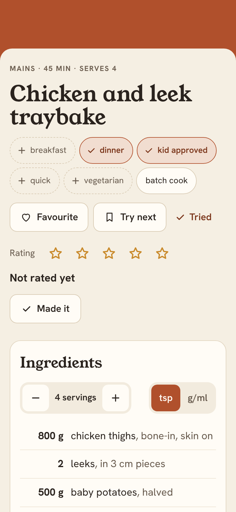
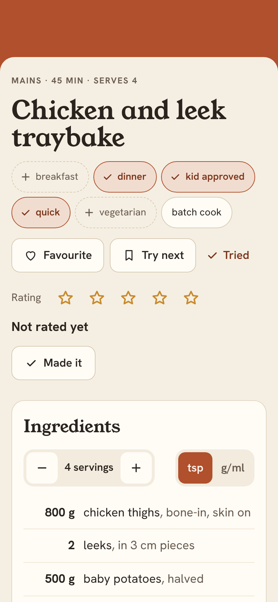
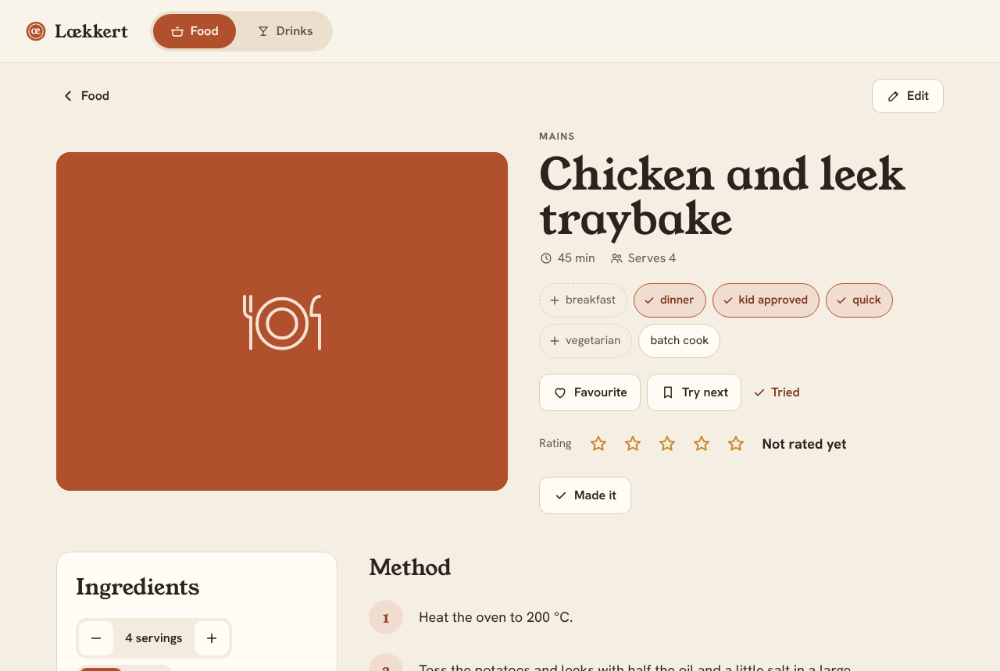
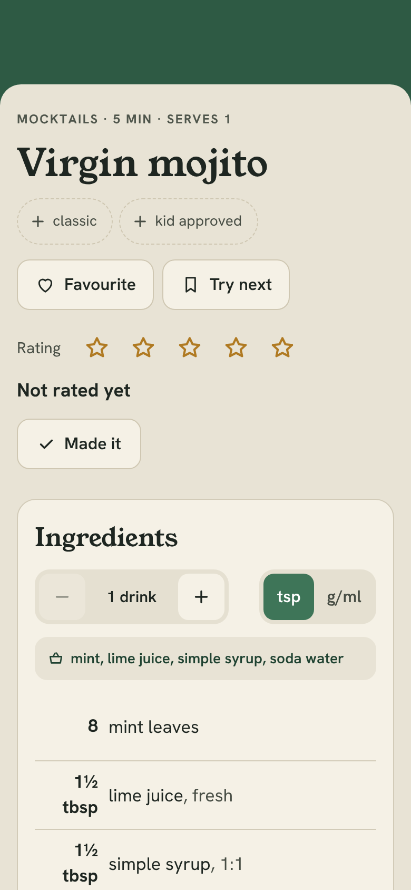
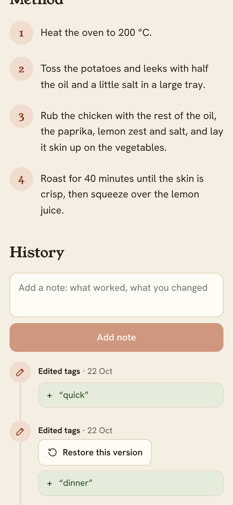

# Quick tag toggles on the recipe page — design

Serwan wants to add common tags straight from a recipe page. Example: the kids liked
something, so he taps "kid approved" on that recipe instead of opening the editor, finding
the tags field and typing it.

Screenshots (built from the working code on seed data): `docs/design/screenshots/quick-tag-toggles/`.

## Why

- Adding a tag today means Edit → scroll to Tags → type it (spelled the same as everywhere
  else) → Save. That's too much for something you notice at the table.
- The tags that matter most are already listed: `food_quick_tags` drives the one-tap
  filters on the Food page (M7). The tags you filter by are the ones you want to set fast.
- Marks (Favourite, Try next) and the rating already work in one tap on the recipe page.
  Tags should too.

## Goals

- On every recipe page the side's **quick tags** are one-tap toggles: tap to add, tap
  again to take off.
- Food uses `food_quick_tags`. Drinks get their own list, `drinks_quick_tags`.
- A toggle is saved at once and shows in History like any other edit, so it can be undone
  or restored.

## Non-goals

- Typing a new tag on the recipe page. Free-form tags stay in the editor.
- Changing the quick tag lists in the app. They stay in `config.toml` (home-server PR).
- Changing the Food page quick filters.

## What it looks like

The Tags row under the title changes. In order:

1. **The quick tags**, in the configured order, always shown, whether the recipe has them
   or not:
   - **Off:** a dashed outline pill, muted text, a `+` icon. ("+ breakfast")
   - **On:** filled like a pressed mark (`--accent-soft`, `--accent` border, semibold), a
     check icon. ("✓ kid approved")
2. **The recipe's other tags**, as they look today: solid pills that link to the browse
   page filtered by that tag.

| Phone, before | After tapping "quick" | Desktop |
| --- | --- | --- |
|  |  |  |

| A mocktail | History after two taps |
| --- | --- |
|  |  |

- The pills keep their positions when tapped. Only the style changes, so nothing moves
  under your finger.
- Each pill is a button with `aria-pressed`, at least 44 px tall, like the mark toggles.
  All of them are disabled while any write on the page is running, the same as marks and
  stars.
- A failed save shows its sentence under the head area (where a failed mark shows) and
  the pill stays as it was.
- A recipe with no tags still shows the row, because the quick tags are always offered.
- A quick tag that only repeats the category is never offered. "mocktail" on a mocktail
  would be dropped by the server anyway.
- Matching works by name key, as on the Food page, so `Kid approved` in the settings
  matches `kid approved` on a recipe. Taking a tag off sends the recipe's own spelling.
- The page loads the settings with the recipe. Until they arrive, every tag shows as a
  link, as today. If the request fails, the default lists are used.

## Settings

`food_quick_tags` is unchanged and gains one line in its comment. New setting:

```toml
# Tags each drink's page shows as one-tap tag toggles, in this order.
# [] shows none.
drinks_quick_tags = ["classic", "kid approved"]
```

`GET /api/settings` returns both lists. An older home-server `config.toml` without the
key just uses the default.

## Server

`POST /api/recipes/{side}/{slug}/tags` with `{"add": [...], "remove": [...]}` (both
optional lists of strings) returns the recipe, like the marks route.

- It's saved as a **new version** with an Edit entry ("Edited tags: + “quick”"), through
  the same code path as an editor save. Restore and the diff work as they already do.
- No base version is needed: it only adds and takes off, so it can't overwrite someone
  else's change. Tags are normalised as the editor does (lowercase, single spaces). Adding
  a tag the recipe has, or taking off one it doesn't, saves nothing.
- The same tag in both `add` and `remove` is a 400.
- The MCP tools don't change. `edit_recipe` already sets tags.

## Decisions to confirm

1. **A quick tag that is on is a toggle, not a link.** Tapping "✓ kid approved" takes the
   tag off; it no longer opens the browse page filtered by it. Food has that filter one tap
   away at the top of the Food page anyway. The other choice is to keep all tags as links
   and add a second row of toggles. That shows "kid approved" twice and makes the head of
   the page taller on a phone. **Recommended: toggles, as shown.**
2. **Each tap is a version in History**, like an editor save. That makes it undoable with
   Restore, and History says who changed what. The cost is two "Edited tags" entries if
   you tap on and off by mistake. The alternative is a lighter "tags" entry like marks,
   without a version. That's more code and gives no Restore. **Recommended: a version.**
3. **Drinks default to `classic` and `kid approved`.** `classic` is the only tag drinks
   use today. Kid approved fits mocktails, but it shows on cocktails too, since there's
   one list per side. Change the list to whatever you'd actually tap.
4. **The off style is dashed and muted** so the tags a recipe really has stand out. On a
   phone, five food quick tags plus the recipe's own tags take two to three lines (see the
   screenshots).

## Tests

- Store: add/remove saves a version with the right diff; no change saves nothing; marks
  are kept; add+remove of the same tag is refused; unknown recipe is `None`.
- API: the route adds and removes; body checks (400); 404 for an unknown recipe; refuses
  non-JSON (415); settings return both lists.
- Web: `tagToggles` ordering and matching; recipe page shows the toggles in order and the
  other tags as links; uses the default lists when settings fail; a tap posts and reloads
  History; tapping an on tag posts `remove` with the recipe's spelling; a failed tap shows
  the error and keeps the state; a drink uses the drinks list and never its own category.
