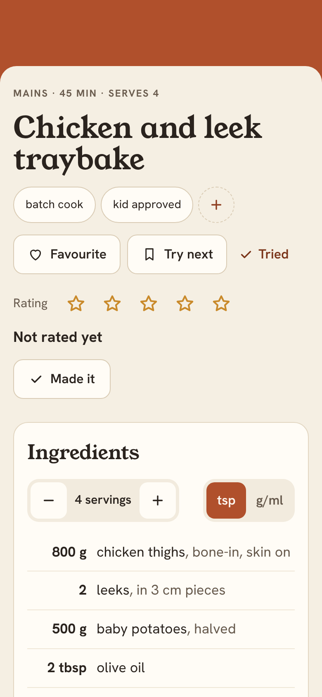
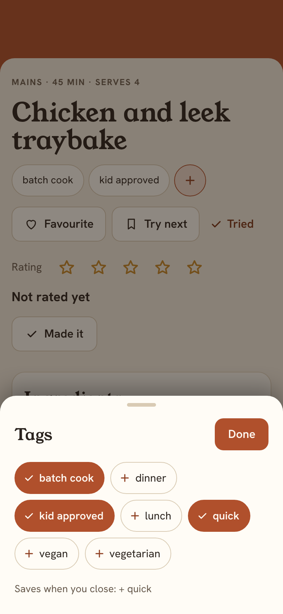
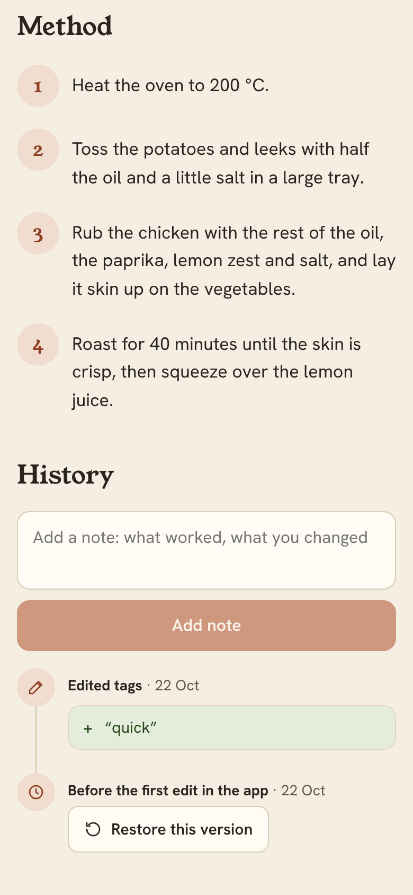
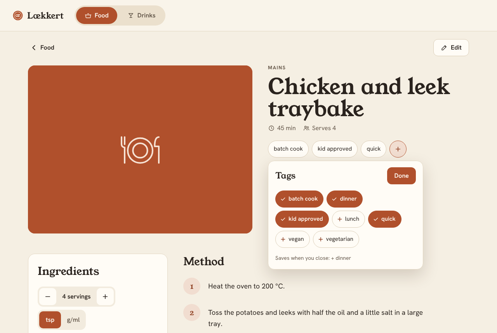

# Tag picker on the food recipe page — design

Serwan wants to tag a recipe straight from its page. Example: the kids liked something, so
he adds "kid approved" there and then, instead of opening the editor, finding the tags field
and typing it.

Mockup (approved): https://claude.ai/artifact/2Yj8xNTqHShHsAR3CZ48oE. Screenshots of the
built page: `docs/design/screenshots/tag-picker/`.

## Why

- Adding a tag today means Edit → scroll to Tags → type it (spelled the same as everywhere
  else) → Save. That's too much for something you notice at the table.
- Marks (Favourite, Try next) and the rating already work in one tap on the recipe page.
  Tags should be nearly as quick.

## Goals

- On a **food** recipe page, a **+** after the tags opens a picker with every tag the food
  recipes use. Tap tags on and off, close the picker, and the change is saved.
- The change is one new version with one Edit entry in History, so it can be undone with
  Restore.

## Non-goals

- Drinks. Serwan isn't sure he'll use tags there; the drinks page stays as it is.
- Making a brand-new tag in the picker. New tags are typed in the editor; once one recipe
  has a tag, the picker offers it for all the others.
- Searching the list. There are few enough tags to show them all.
- Changing `food_quick_tags`. It still drives the Food page's quick filters only.

## What it looks like

| Phone | Phone, picker open | History after Done |
| --- | --- | --- |
|  |  |  |

**The tag row.** The recipe's tags stay links to the Food page filtered by that tag, as
today. After them comes a round dashed **+** button ("Edit tags"). A recipe with no tags
shows the row with just **+ Add tags**.

**The picker.** A bottom sheet on a phone; on desktop a popover under the tag row. It has a
"Tags" heading, a **Done** button, and one list of pills: every tag used by any food recipe,
plus the recipe's own, A to Z.

- A tag the recipe has is filled with the accent colour and a check. The others are plain
  with a +. Each pill is a button with `aria-pressed`.
- Taps change only the picker. The footer says what will be saved ("Saves when you close:
  + kid approved, − dinner"), or "Tap a tag to add it or take it off." when nothing changed.
- **Done**, a tap outside or Escape closes it and saves. Nothing changed means nothing is
  sent.
- The list loads when the picker opens. Until it arrives the picker says "Loading tags…". If
  it fails, the picker shows the recipe's own tags and the error, so tags can still be taken
  off.
- A tag that only repeats the category ("main" on a main) is left out; the server would
  drop it anyway.
- Matching is by name key, as on the Food page, so `Kid approved` and `kid approved` are one
  tag. Taking a tag off sends the recipe's own spelling.
- While the save runs, the page's write buttons are disabled, as for marks. A failed save
  shows its sentence under the head area (where a failed mark shows); the tags stay as they
  were.

## Server

`POST /api/recipes/{side}/{slug}/tags` with `{"add": [...], "remove": [...]}` (both
optional lists of strings) returns the recipe, like the marks route.

- It's saved as a **new version** with an Edit entry ("Edited tags: + “kid approved”"),
  through the same code path as an editor save. Restore and the diff work as they already do.
- No base version is needed: it only adds and takes off, so it can't overwrite someone
  else's change. Tags are normalised as the editor does (lowercase, single spaces). Added
  tags go at the end. Adding a tag the recipe has, or taking off one it doesn't, saves
  nothing.
- The same tag in both `add` and `remove` is a 400.
- The route isn't limited to food; only the food page uses it for now.
- The tag list needs no new route: the picker reads `GET /api/recipes?side=food` and
  collects the tags.
- The MCP tools don't change. `edit_recipe` already sets tags.

## Tests

- Store: add/remove saves a version with the right diff; no change saves nothing; marks
  are kept; add and remove of the same tag is refused; unknown recipe is `None`.
- API: the route adds and removes; body checks (400); 404 for an unknown recipe; refuses
  non-JSON (415).
- Web: the picker's list (union, A to Z, one per name key, no category tag) and the change
  it sends; the recipe page shows **+** on food and not on drinks; opening loads the tags;
  toggling and Done posts one change and reloads History; closing without a change posts
  nothing; a failed load still lists the recipe's tags; a failed save shows the error.
